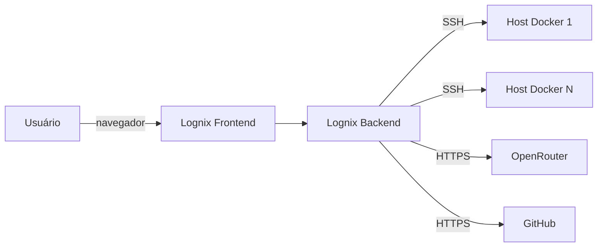
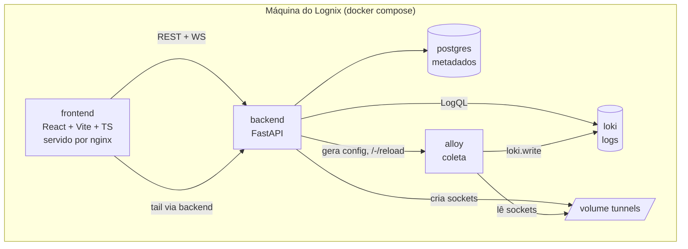
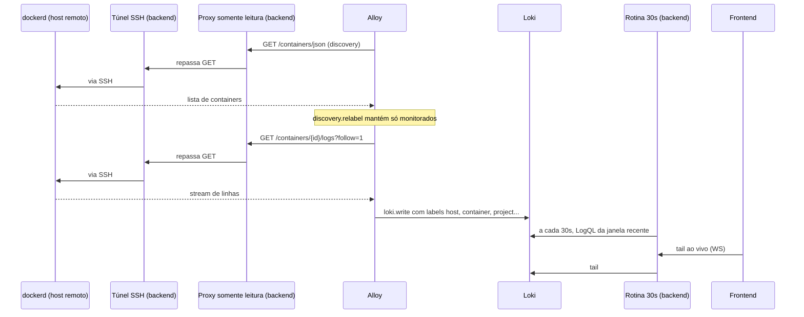
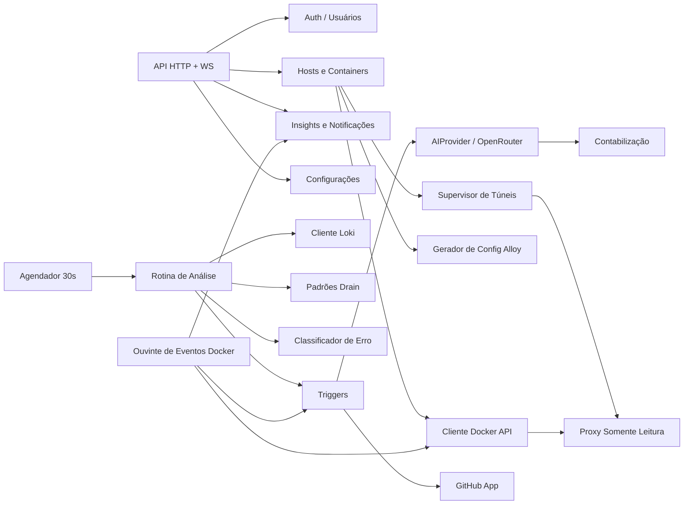
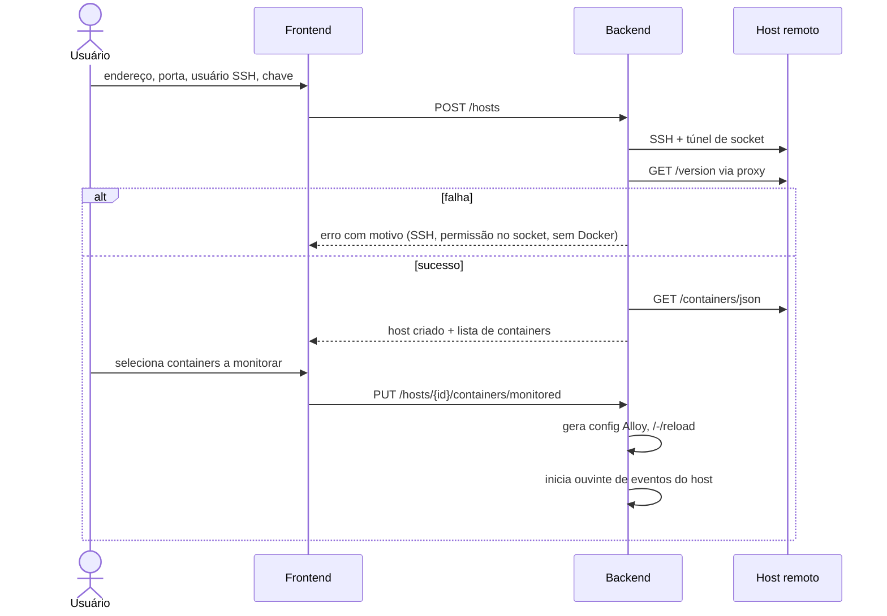
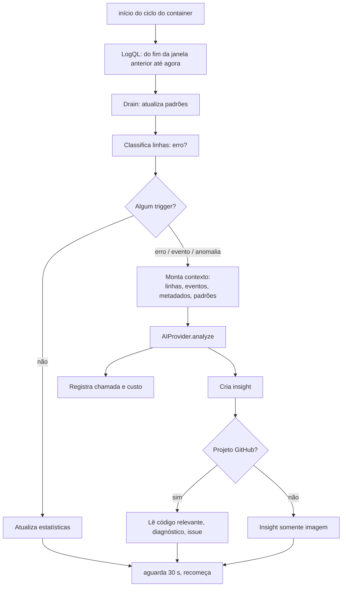
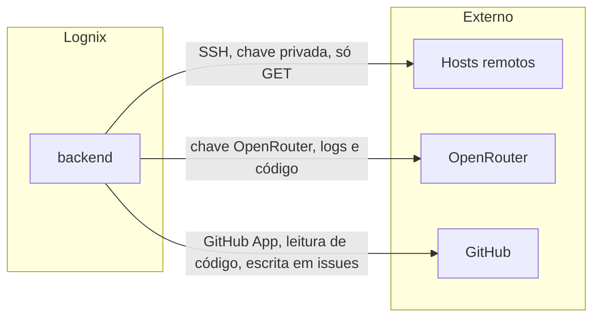

# Arquitetura Geral

**Status:** Rascunho para revisão · **Atualizado:** 2026-11-21

Consolida as decisões dos ADRs 001 a 009 em uma visão única do sistema.

## 1. Contexto

O Lognix roda em uma máquina com Docker. Alcança os hosts monitorados por SSH, saída apenas. Usa dois
serviços externos: OpenRouter para IA e GitHub para código e issues. Nenhum host monitorado precisa
alcançar o Lognix.

## 2. Containers do Lognix

| Container | Responsabilidade | Estado |
|---|---|---|
| frontend | Interface. Arquivos estáticos servidos por nginx, que também faz proxy de `/api` para o backend | Sem estado |
| backend | API, autenticação, supervisor de túneis, proxy somente leitura, ciclos de análise, triggers, IA, GitHub, gerador de config do Alloy | Instância única |
| postgres | Usuários, hosts, containers, insights, chamadas de IA, notificações, issues, configurações | Volume `postgres-data` |
| loki | Logs dos containers monitorados | Volume `loki-data` |
| alloy | Descobre containers via sockets espelhados, filtra os monitorados, envia ao Loki | Config gerada pelo backend |
| volume tunnels | Sockets Unix espelhados, um por host | Compartilhado entre backend e alloy |

## 3. Caminho de um log

O backend nunca lê linhas de log pela Docker API. Logs vêm sempre do Loki.

## 4. Módulos do backend

| Módulo | O que faz | Referência |
|---|---|---|
| Auth / Usuários | Login, JWT, cadastro | ADR 008 |
| Hosts e Containers | CRUD de hosts, validação de conexão, inventário, seleção de monitorados | Área 03 |
| Supervisor de Túneis | Abre, vigia, reconecta e encerra túneis SSH | ADR 002 |
| Proxy Somente Leitura | Único caminho para a Docker API, só `GET` | ADR 003 |
| Cliente Docker API | Inventário, inspeção, eventos | ADR 004 |
| Gerador de Config Alloy | Um bloco por host, filtro de monitorados, `/-/reload` | Área 03 |
| Ouvinte de Eventos Docker | `GET /events` por host: start, die, oom, restart. Gera notificação de container novo e alimenta triggers | Área 03 |
| Agendador | Mantém um ciclo por container monitorado, com 30 s entre o fim de um e o início do próximo | ADR 005, ADR 009 |
| Rotina de Análise | Consulta Loki, agrupa, classifica, avalia triggers | ADR 005 |
| Padrões Drain | Templates por container | Área 04 |
| Classificador de Erro | Nível estruturado ou regex | Área 04 |
| Triggers | Erro, evento crítico, anomalia, manual | Área 04 |
| AIProvider | Interface única, implementação OpenRouter | ADR 006 |
| Contabilização | Registro de cada chamada de IA | ADR 006 |
| GitHub App | Leitura de código, issues | ADR 007, área 09 |
| Insights e Notificações | Persistência, visto, limpar todos | Modelo de Dados |
| Configurações | Provider de IA, GitHub App, criptografadas | ADR 006, ADR 007 |

## 5. Fluxos principais

### 5.1 Cadastro de host

### 5.2 Ciclo de análise por container

Cada container monitorado tem seu próprio ciclo. A IA é aguardada dentro do ciclo. Os 30 s contam a partir do fim do ciclo, IA incluída. ADR 005 revisado.

### 5.3 Container novo no host

Ouvinte de eventos recebe `start` de um container desconhecido. Backend cria o registro como
não monitorado, gera notificação "novo container X no host Y". Usuário decide. Se aceitar, entra no
fluxo de seleção e o Alloy é recarregado.

### 5.4 Túnel caído

Supervisor detecta falha. Marca host como desconectado, gera notificação, tenta reconectar com
backoff exponencial. Coleta daquele host para até reconectar. Alloy continua com os outros hosts.

## 6. Fronteiras de confiança

- Chaves SSH, chave do OpenRouter e chave privada do GitHub App ficam criptografadas no Postgres.
- Trechos de log e de código **saem** para o OpenRouter. Isso é inerente ao produto e precisa estar
  claro na documentação e na interface. Redação de dados sensíveis fica em Guardrails, área 04.
- Nenhum comando de alteração chega aos hosts. Proxy do ADR 003.

## 7. O que esta arquitetura ainda não cobre

- Kubernetes. A entidade Host precisa aceitar outro tipo de runtime no futuro.
- Mais de uma instância de backend. ADR 009.
- Hosts atrás de bastion/jump host. Candidato ao roadmap.
