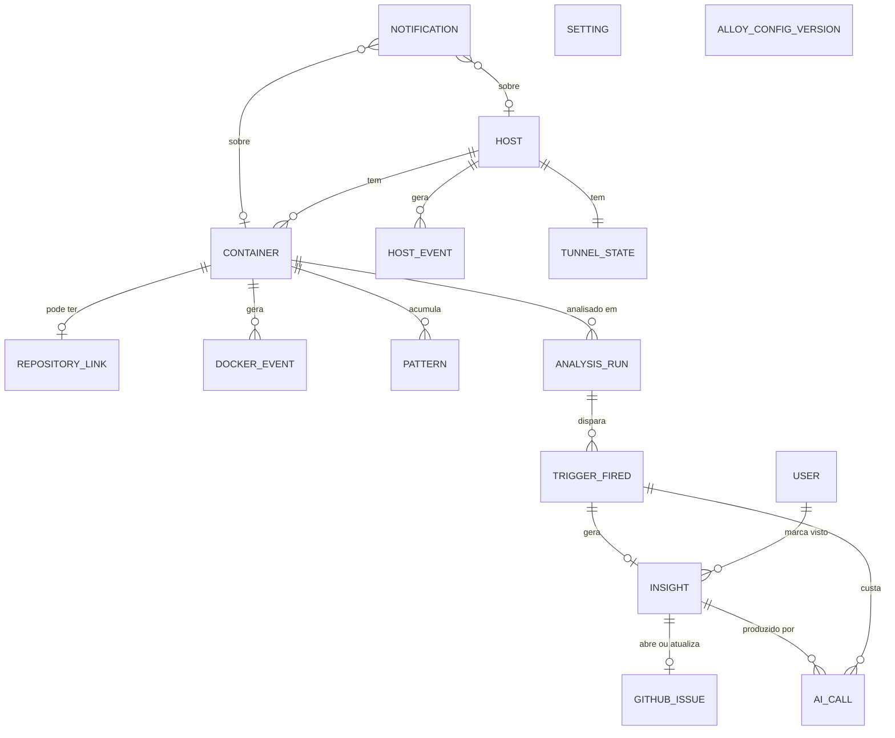

# Modelo de Dados

**Status:** Em revisão. Host, TunnelState, Container e AlloyConfigVersion aprovados em 2026-11-21 · **Atualizado:** 2026-11-21

Tudo que o Lognix **produz** fica no PostgreSQL. Linhas de log ficam **só no Loki**. Este documento
descreve as entidades do Postgres e os labels do Loki.

## 1. Visão geral

## 2. Entidades

### User
| Campo | Tipo | Nota |
|---|---|---|
| id | uuid | |
| email | text, único | login |
| password_hash | text | argon2 |
| name | text | |
| created_at | timestamptz | |

Sem papéis na v1. ADR 008.

### RefreshToken
| Campo | Tipo |
|---|---|
| jti | uuid, pk |
| user_id | uuid → User |
| family_id | uuid, para invalidar a família em reuso |
| expires_at | timestamptz |
| revoked_at | timestamptz, nulo |

### Host
Uma máquina com Docker alcançável por SSH. Abstração neutra para Kubernetes futuro via `runtime`.

| Campo | Tipo | Nota |
|---|---|---|
| id | uuid | |
| name | text | apelido dado pelo usuário |
| address | text | IP ou DNS |
| ssh_port | int | padrão 22 |
| ssh_user | text | |
| ssh_auth_method | enum | `key`, `key_passphrase`, `password` |
| ssh_private_key_enc | bytea, nulo | criptografada com chave do servidor |
| ssh_key_passphrase_enc | bytea, nulo | criptografada |
| ssh_password_enc | bytea, nulo | criptografada |
| ssh_host_key_fingerprint | text | fixado no primeiro acesso, protege contra MITM |
| runtime | enum | `docker` na v1 |
| docker_version | text | obtido em `GET /version` |
| status | enum | `pending`, `connected`, `disconnected`, `error` |
| last_error | text | motivo legível |
| created_by | uuid → User | |
| created_at, updated_at | timestamptz | |

### TunnelState
Estado operacional do túnel, separado de Host para gravar com frequência sem tocar na entidade principal.

| Campo | Tipo |
|---|---|
| host_id | uuid, pk → Host |
| socket_path | text |
| connected_since | timestamptz |
| last_check_at | timestamptz |
| reconnect_attempts | int |
| last_error | text |

### Container
Um projeto. Existe para todo container visto no host, monitorado ou não.

| Campo | Tipo | Nota |
|---|---|---|
| id | uuid | |
| host_id | uuid → Host | |
| docker_id | text | ID completo do Docker |
| name | text | nome atual |
| image | text | `repo:tag` |
| image_digest | text | |
| compose_project | text, nulo | de label `com.docker.compose.project` |
| compose_service | text, nulo | |
| labels | jsonb | labels Docker brutas, inclui OCI |
| state | enum | `running`, `exited`, `restarting`, `paused`, `dead`, `removed` |
| monitored | bool | padrão `false` |
| monitored_since | timestamptz | |
| kind | enum, derivado | `image` sem RepositoryLink, `github` com |
| first_seen_at, last_seen_at | timestamptz | |

Container que desaparece do host fica com `state = removed` e `monitored = false`, automaticamente. Não é apagado: aparece na aba **Containers excluídos** da interface e seus insights continuam acessíveis.

**Exceção, redeploy:** se logo após o sumiço aparece no mesmo host um container com a mesma identidade de serviço, mesmo `compose_project` e `compose_service`, ou mesmo `name` quando não há Compose, o Lognix mantém o mesmo `Container.id`, atualiza `docker_id`, `image` e `image_digest`, continua monitorando e grava um `DockerEvent` do tipo `redeploy`. Ver Monitoramento Docker seção 6.

### RepositoryLink
| Campo | Tipo | Nota |
|---|---|---|
| container_id | uuid, pk → Container | |
| provider | enum | `github` na v1 |
| owner, repo | text | |
| default_ref | text | branch ou commit a usar quando a imagem não informa |
| subpath | text, nulo | subdiretório do serviço em monorepo, restringe a leitura de código |
| source_hint | enum | `oci_label`, `manual` |
| installation_id | text | instalação do GitHub App que cobre o repo |
| created_at | timestamptz | |

Só repositórios de código. Validação na interface e no backend.

### DockerEvent
| Campo | Tipo |
|---|---|
| id | bigserial |
| container_id | uuid → Container |
| type | enum: `start`, `die`, `oom`, `restart`, `kill`, `stop`, `health_status`, `redeploy` |
| previous_image, new_image | text, nulos. Só em `redeploy` |
| exit_code | int, nulo |
| attributes | jsonb |
| occurred_at | timestamptz |

Retenção: igual à do Loki, padrão 15 dias.

### HostEvent
Eventos do próprio host no Lognix: conectado, desconectado, container novo detectado, falha.
Mesma estrutura que DockerEvent sem `container_id`.

### Pattern
Templates do Drain por container.

| Campo | Tipo |
|---|---|
| id | uuid |
| container_id | uuid → Container |
| template | text, ex.: `user <*> logged in from <*>` |
| level | enum: `error`, `warn`, `info`, `unknown` |
| count_total | bigint |
| first_seen_at, last_seen_at | timestamptz |
| sample | text, última linha real |
| ignored | bool | padrão `false`. Marcado pelo usuário: não abre nem reabre issue para este padrão |

### AnalysisRun
Um ciclo de 30 s para um container.

| Campo | Tipo |
|---|---|
| id | bigserial |
| container_id | uuid → Container |
| window_start, window_end | timestamptz, janela real: do fim da anterior até o início deste ciclo |
| ai_called | bool |
| ai_duration_ms | int, nulo |
| lines_count | int |
| error_lines_count | int |
| new_patterns_count | int |
| duration_ms | int |
| status | enum: `ok`, `skipped`, `failed` |

Um por ciclo por container. Retenção curta, 7 dias, serve para medir a rotina e detectar anomalia de volume.

### TriggerFired
| Campo | Tipo |
|---|---|
| id | uuid |
| analysis_run_id | bigint → AnalysisRun, nulo se manual |
| container_id | uuid → Container |
| type | enum: `error`, `docker_event`, `anomaly`, `manual` |
| reason | jsonb, ex.: padrões de erro, evento, desvio |
| fired_by | uuid → User, nulo exceto manual |
| fired_at | timestamptz |

### Insight
| Campo | Tipo | Nota |
|---|---|---|
| id | uuid | |
| container_id | uuid → Container | |
| trigger_id | uuid → TriggerFired | |
| severity | enum | `critical`, `high`, `medium`, `low`, `info` |
| title | text | uma linha |
| summary | text | o que aconteceu |
| probable_cause | text | |
| suggested_action | text | |
| evidence | jsonb | referências às linhas: labels + timestamps + texto, e eventos |
| code_diagnosis | jsonb, nulo | arquivo, trecho, linhas, explicação. Só `kind = github` |
| confidence | numeric(3,2) | 0 a 1, vindo da IA |
| context_truncated | bool | contexto cortado por limite de tokens |
| sent_context | text | contexto exato enviado à IA, para transparência |
| status | enum | `new`, `seen` |
| seen_by | uuid → User, nulo | |
| seen_at | timestamptz, nulo | |
| created_at | timestamptz | |

"Limpar todos" faz `UPDATE ... SET status = seen` em lote. Nada é apagado. Histórico em tela própria.

### AICall
| Campo | Tipo |
|---|---|
| id | uuid |
| trigger_id | uuid → TriggerFired |
| insight_id | uuid → Insight, nulo se falhou |
| provider | enum: `openrouter` |
| model | text |
| prompt_version | text |
| schema_retry | bool, true se foi o retry de esquema |
| purpose | enum: `analyze`, `code_diagnosis`, `issue_text` |
| input_tokens, output_tokens | int |
| cost_usd | numeric(12,6) |
| cost_source | enum: `provider`, `estimated` |
| latency_ms | int |
| status | enum: `ok`, `error` |
| error | text |
| created_at | timestamptz |

Nunca apagado. Base da tela de consumo.

### GithubIssue
| Campo | Tipo |
|---|---|
| id | uuid |
| container_id | uuid → Container |
| pattern_id | uuid → Pattern, chave de deduplicação junto com container |
| owner, repo, number | text, text, int |
| state | enum: `open`, `closed` |
| occurrences | int |
| last_comment_at | timestamptz |
| reopened_count | int |
| created_at, updated_at | timestamptz |

Regra: uma issue por `(container_id, pattern_id)`. Recorrência comenta. Fechada e voltou, reabre.

### Notification
| Campo | Tipo |
|---|---|
| id | uuid |
| type | enum: `new_container`, `host_disconnected`, `host_reconnected`, `analysis_skipped`, `ai_error`, `github_error` |
| host_id | uuid, nulo |
| container_id | uuid, nulo |
| payload | jsonb |
| status | enum: `new`, `seen` |
| seen_by, seen_at | |
| created_at | timestamptz |

### Setting
Configurações globais, chave/valor, valores sensíveis criptografados.

| key | conteúdo |
|---|---|
| `ai.openrouter.api_key` | criptografado |
| `ai.openrouter.model` | ex.: `anthropic/claude-...` escolhido pelo usuário |
| `github.app.id`, `github.app.private_key`, `github.app.installation_id` | criptografados |
| `analysis.interval_seconds` | 30, fixo na v1, preparado para roadmap |
| `loki.retention_days` | espelha o `.env`, só leitura na interface |

### AlloyConfigVersion
| Campo | Tipo |
|---|---|
| id | bigserial |
| content | text, o `.alloy` completo |
| hash | text |
| reason | text, ex.: "host vm-01 adicionado", "container api monitorado" |
| applied_at | timestamptz |
| reload_ok | bool |

Permite auditar e reverter a config do Alloy.

## 3. Labels no Loki

Poucos e de baixa cardinalidade. ADR 001.

| Label | Origem | Exemplo |
|---|---|---|
| `host` | nome do Host no Lognix | `vm-01` |
| `host_id` | uuid do Host | |
| `container` | nome do container | `api` |
| `container_id` | uuid do Container no Lognix, não o do Docker, para sobreviver a recriação | |
| `compose_project` | label Docker, se existir | `lognix` |
| `compose_service` | label Docker, se existir | `api` |
| `stream` | `stdout` ou `stderr` | |

Proibidos como label: request id, user id, nível de log parseado. Esses ficam no conteúdo e são
extraídos por LogQL quando necessário.

## 4. Retenção

| Dado | Onde | Retenção padrão |
|---|---|---|
| Linhas de log | Loki | 15 dias, `.env` |
| DockerEvent, HostEvent | Postgres | 15 dias |
| AnalysisRun | Postgres | 7 dias |
| Pattern | Postgres | enquanto o container existir |
| Insight, Notification | Postgres | permanente, histórico |
| AICall | Postgres | permanente |
| GithubIssue | Postgres | permanente |
| AlloyConfigVersion | Postgres | últimas 100 versões |

## 5. Criptografia em repouso

Campos marcados como criptografados usam uma chave simétrica definida no `.env`, `LOGNIX_SECRET_KEY`.
Perder essa chave torna credenciais SSH, OpenRouter e GitHub irrecuperáveis. A documentação de
instalação precisa deixar isso explícito.

## 6. Decisões confirmadas em 2026-11-21

1. Container removido do host para de ser monitorado e vai para a aba Containers excluídos. Insights se mantêm.
2. Insight visto não é apagado. Sai da tela principal, continua acessível no histórico.
3. Retenção padrão: logs 15 dias, eventos Docker e de host 15 dias, ciclos de análise 7 dias, o resto permanente.
4. O ID do Lognix é a fonte de verdade para container em todo o sistema, inclusive como label no Loki. O ID do Docker é só atributo.
