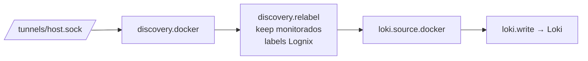

# Grafana Alloy

**Status:** Rascunho para revisão · **Atualizado:** 2026-11-21

Como o Alloy é usado no Lognix. Base: ADR 002, 003, 004 e 005.

## 1. Papel

O Alloy é o **único** componente que lê linhas de log. Roda como container ao lado do backend. Para
cada host cadastrado recebe um bloco de pipeline que:

1. descobre containers pelo socket espelhado do host;
2. mantém só os containers **monitorados**;
3. aplica os labels do Lognix;
4. lê os logs e envia ao Loki.

O Alloy não sabe que existe SSH. Para ele, cada host é um Docker local em `/tunnels/<host_id>.sock`.
Esse socket é, na verdade, o proxy somente leitura do backend, que por sua vez fala com o túnel.

## 2. Pipeline por host



## 3. Config gerada, exemplo

Gerada pelo backend. Um bloco de `discovery.docker`, `discovery.relabel` e `loki.source.docker` por
host. Um único `loki.write`. Identificadores de componente usam o `host_id` sem hífens.

```alloy
// ---- host vm-01 (id 3f2a...) ----
discovery.docker "h_3f2a" {
  host             = "unix:///tunnels/3f2a.sock"
  refresh_interval = "15s"
}

discovery.relabel "h_3f2a" {
  targets = discovery.docker.h_3f2a.targets

  // mantém só containers monitorados, por ID Docker
  rule {
    source_labels = ["__meta_docker_container_id"]
    regex         = "(9c1d.*|77ab.*)"
    action        = "keep"
  }

  // labels fixos do host
  rule { target_label = "host";    replacement = "vm-01" }
  rule { target_label = "host_id"; replacement = "3f2a..." }

  // nome do container sem a barra inicial
  rule {
    source_labels = ["__meta_docker_container_name"]
    regex         = "/(.*)"
    target_label  = "container"
  }

  // container_id do Lognix, um rule por container monitorado
  rule {
    source_labels = ["__meta_docker_container_id"]
    regex         = "9c1d.*"
    target_label  = "container_id"
    replacement   = "b7e0-uuid-lognix"
  }
  rule {
    source_labels = ["__meta_docker_container_id"]
    regex         = "77ab.*"
    target_label  = "container_id"
    replacement   = "c912-uuid-lognix"
  }

  // compose, se existir
  rule {
    source_labels = ["__meta_docker_container_label_com_docker_compose_project"]
    target_label  = "compose_project"
  }
  rule {
    source_labels = ["__meta_docker_container_label_com_docker_compose_service"]
    target_label  = "compose_service"
  }
}

loki.source.docker "h_3f2a" {
  host             = "unix:///tunnels/3f2a.sock"
  targets          = discovery.relabel.h_3f2a.output
  forward_to       = [loki.write.default.receiver]
  refresh_interval = "15s"
}

// ---- destino único ----
loki.write "default" {
  endpoint {
    url = "http://loki:3100/loki/api/v1/push"
  }
}
```

## 4. Regras de geração

| Regra | Motivo |
|---|---|
| Um bloco por host, nunca um Alloy por host | Um processo, uma config, um reload |
| Filtro `keep` por ID Docker dos monitorados | Container não monitorado não gera tráfego nem ocupa Loki |
| Host sem container monitorado não gera bloco | Evita descoberta inútil |
| `container_id` é o uuid do Lognix | Fonte de verdade. Recriar o container não quebra histórico |
| Labels limitados aos definidos no Modelo de Dados | Baixa cardinalidade no Loki |
| Config completa é regravada a cada mudança | Simples e determinística. Nada de edição incremental |
| Cada versão vai para `AlloyConfigVersion` com hash e motivo | Auditoria e reversão |

## 5. Recarga

1. Backend escreve o arquivo em um volume compartilhado com o Alloy, em caminho temporário.
2. Renomeia para o caminho definitivo, operação atômica.
3. Chama `POST http://alloy:12345/-/reload`.
4. Se a resposta for erro, registra `reload_ok = false`, restaura a versão anterior e gera notificação.

Gatilhos de recarga: host adicionado, removido ou renomeado; container marcado ou desmarcado;
container monitorado removido do host.

## 6. Coleta começa na marcação

Quando um container é marcado como monitorado, o Alloy passa a ler **a partir daquele momento**. Logs
anteriores à marcação não são coletados. Motivo: um container com histórico longo despejaria tudo de
uma vez no Loki e dispararia dezenas de triggers por erros antigos.

O `loki.source.docker` guarda posição de leitura por container em arquivo de posições. Isso evita
duplicar linhas após reinício do Alloy. Para um container recém-marcado, sem posição anterior, o
comportamento padrão precisa ser **verificado em protótipo**: se o componente iniciar do começo do
log em vez de "agora", o backend deve forçar início em "agora". Item obrigatório da fase de protótipo.

## 7. O que o Alloy não faz no Lognix

- Não coleta métricas. Roadmap.
- Não coleta eventos Docker. Isso é do backend, ADR 004.
- Não faz parse de conteúdo. Nível, JSON e regex são tratados pelo backend sobre o resultado do LogQL,
  mantendo o Alloy burro e a lógica de classificação versionada em Python.
- Não roda no host monitorado. Roadmap para instalações grandes.

## 8. A verificar em protótipo

| Item | Por quê |
|---|---|
| Comportamento de `loki.source.docker` em alvo novo sem posição | Seção 6 |
| Se o label `stream` (`stdout`/`stderr`) é adicionado automaticamente | Modelo de Dados o prevê |
| Latência de descoberta com `refresh_interval = 15s` sobre túnel SSH | Afeta tempo até o primeiro log após marcação |
| Consumo de memória do Alloy com 10 hosts e 100 containers | Dimensionamento do compose |
| Comportamento quando um socket espelhado desaparece | Túnel caído, ADR 002 |
