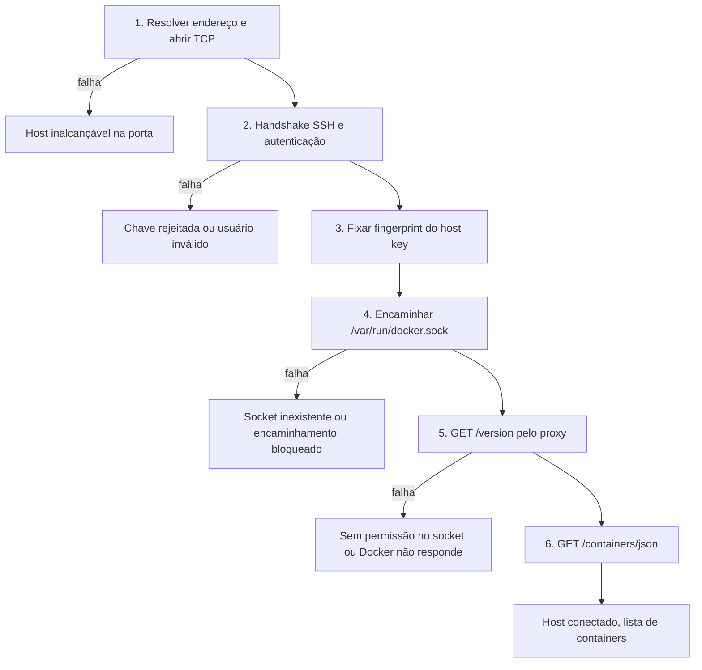
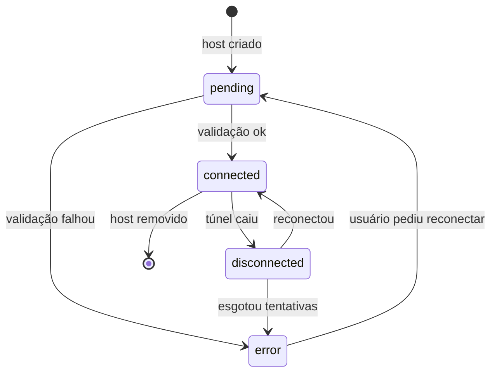

# Inventário e Conexão de Instâncias

**Status:** Aprovado em 2026-11-21 · **Atualizado:** 2026-11-21

Como um host entra no Lognix, como a conexão é mantida e o que acontece quando falha. Base: ADR 002 e 003.

## 1. Cadastro

Campos pedidos ao usuário:

| Campo | Obrigatório | Validação |
|---|---|---|
| Nome | sim | único, vira label `host` no Loki, só letras, números, `-` e `_` |
| Endereço | sim | IP ou DNS |
| Porta SSH | não, padrão 22 | 1 a 65535 |
| Usuário SSH | sim | |
| Método de autenticação | sim | `chave`, `chave com passphrase` ou `senha` |
| Chave privada | se método for chave | formato OpenSSH ou PEM |
| Passphrase da chave | se a chave tiver | criptografada, usada só para carregar a chave em memória |
| Senha | se método for senha | criptografada |

Autenticação SSH **completa** na v1: chave, chave com passphrase e senha. Decisão de 2026-11-21.
A interface recomenda chave e avisa que senha é a opção menos segura, mas não bloqueia. Todas as
credenciais ficam criptografadas no banco, ADR 008 e Modelo de Dados seção 5.

## 2. Validação em etapas

O backend executa e devolve ao frontend o resultado de cada etapa, para que a falha seja legível.



Cada mensagem de erro inclui a ação sugerida. Exemplo para a etapa 5: "O usuário `deploy` não tem
acesso ao Docker. No host, execute `sudo usermod -aG docker deploy` e reconecte."

## 3. Fingerprint do host

No primeiro acesso bem-sucedido, o fingerprint da chave pública do servidor SSH é gravado em
`Host.ssh_host_key_fingerprint`. Em conexões seguintes, divergência interrompe a conexão, marca o host
como `error` e gera notificação. O usuário pode aceitar o novo fingerprint pela interface. Isso
protege contra interceptação da conexão.

## 4. Ciclo de vida do túnel



Supervisor de túneis, no backend:

| Ação | Regra |
|---|---|
| Verificação de saúde | `GET /_ping` pelo proxy a cada 15 s |
| Detecção de queda | processo SSH encerrou, ou 2 pings seguidos falharam |
| Reconexão | backoff exponencial: 2 s, 4 s, 8 s... até 5 min, sem limite de tentativas |
| Após reconectar | recria o socket no mesmo caminho, o Alloy retoma sozinho |
| Notificação | `host_disconnected` na primeira queda, `host_reconnected` ao voltar. Sem spam a cada tentativa |
| Remoção do host | encerra túnel, apaga socket, remove bloco do Alloy, recarrega |

Um túnel por host. Todas as leituras daquele host passam por ele.

## 5. Proxy somente leitura

Entre o socket do túnel e o socket que o Alloy e o cliente Docker usam, o backend coloca um proxy
HTTP sobre socket Unix.

```
/tunnels/<host_id>.sock         ← o que Alloy e backend usam (proxy)
/tunnels/raw/<host_id>.sock     ← saída do túnel SSH, acessível só ao processo do backend
```

Comportamento:

- Permite apenas método `GET`, e apenas caminhos da lista do ADR 003.
- Qualquer outra requisição recebe `403` e é registrada em log de auditoria com origem e caminho.
- Streams longos, `logs?follow=1` e `events`, são repassados sem buffer.
- O diretório `raw/` tem permissão restrita ao usuário do processo do backend.

## 6. Remoção de host

Remover um host **não apaga** containers, insights, padrões ou chamadas de IA. O host fica com
`status = removed`, oculto da lista principal, com os dados consultáveis em histórico. Apagar de fato
é operação separada, com confirmação, que exclui também os logs daquele host no Loki.

## 7. Limites da v1

- Sem bastion ou jump host. Roadmap.
- Hosts só com runtime Docker. Kubernetes em v2.
