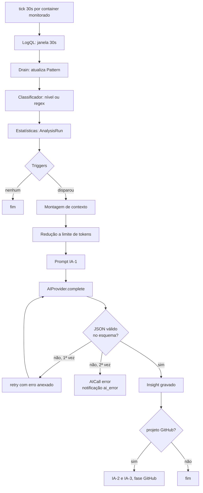

# Pipeline de Análise

**Status:** Rascunho para revisão · **Atualizado:** 2026-11-21

Do tick de 30 s ao insight gravado. Base: ADR 005, ADR 006, decisões de 2026-11-21 sobre contexto e esquema.

## 1. Visão geral



## 2. Montagem de contexto para o trigger de erro

Decidido em 2026-11-21. O contexto enviado à IA contém, nesta ordem de prioridade:

| # | Bloco | Conteúdo | Limite |
|---|---|---|---|
| 1 | Projeto | nome, host, imagem, tipo, compose project/service, variáveis seguras | sempre |
| 2 | Trigger | tipo, motivo, horário | sempre |
| 3 | Linhas de erro | todas as linhas classificadas como erro na janela, com timestamp e stream | até 100 linhas |
| 4 | Contexto anterior | até 50 linhas imediatamente antes da primeira linha de erro | 50 linhas |
| 5 | Eventos Docker | últimos 10 minutos: die, oom, restart, health, redeploy com imagens | até 20 eventos |
| 6 | Padrões | os 10 padrões mais frequentes do container, com contagem, e os padrões **novos** na janela | 10 + novos |
| 7 | Redeploy recente | se houve `redeploy` nas últimas 2 horas: imagem anterior, nova, horário | sempre que existir |
| 8 | Estado atual | `GET /containers/{id}/json`: estado, restarts, health | sempre |

Para trigger de **evento crítico**, o bloco 3 passa a ser "últimas 100 linhas antes do evento".
Para **anomalia**, o bloco 3 são amostras dos padrões que desviaram. Para **manual**, a janela é a
escolhida pelo usuário e o bloco 3 são todas as linhas de erro nela, com o mesmo limite.

## 3. Redução a limite de tokens

Orçamento de entrada por chamada: configurável, padrão 12 000 tokens. Se o contexto exceder, corta
nesta ordem até caber:

1. Contexto anterior, das linhas mais antigas para as mais novas.
2. Linhas de erro repetidas: colapsa linhas com o mesmo padrão em "linha X, repetida N vezes".
3. Padrões frequentes, mantendo só os novos.
4. Eventos, dos mais antigos para os mais novos.

Blocos 1, 2, 7 e 8 nunca são cortados. Se mesmo assim não caber, a chamada é feita com o que couber
e o insight recebe a marca `context_truncated = true`.

Linhas individuais com mais de 2 000 caracteres são truncadas no meio, preservando início e fim.

## 4. Chamada

Interface interna:

```python
class AIProvider(Protocol):
    async def complete(
        self,
        *,
        system: str,
        user: str,
        schema: dict,          # JSON Schema da resposta esperada
        max_output_tokens: int,
        purpose: Purpose,      # analyze | code_diagnosis | issue_text
    ) -> AIResult: ...         # text, input_tokens, output_tokens, cost_usd, cost_source, latency_ms, model
```

A implementação OpenRouter usa o formato de chat compatível com OpenAI, pede saída JSON quando o
modelo suportar e, quando não, instrui no prompt. O esquema vai no prompt em ambos os casos.

## 5. Validação e retry

Decidido em 2026-11-21: **esquema fechado, fora do esquema é retry.**

1. A resposta é parseada como JSON. Texto antes ou depois do JSON é descartado se houver exatamente
   um objeto JSON identificável.
2. O objeto é validado contra o JSON Schema do caso de uso. Campos extras são rejeitados.
3. Falhou: **um** retry, com o erro de validação anexado ao prompt e a resposta anterior citada.
4. Falhou de novo: `AICall.status = error`, notificação `ai_error` com o motivo, **nenhum insight criado**.
   Ambas as chamadas são contabilizadas.
5. Passou: `Insight` criado com `evidence` preenchido pelo backend, não pela IA. A IA referencia
   evidências por índice; o backend resolve para as linhas e eventos reais.

## 6. Esquema do Insight, IA-1

```json
{
  "type": "object",
  "additionalProperties": false,
  "required": ["severity", "title", "summary", "probable_cause", "suggested_action", "evidence_refs", "confidence"],
  "properties": {
    "severity": { "enum": ["critical", "high", "medium", "low", "info"] },
    "title": { "type": "string", "maxLength": 120 },
    "summary": { "type": "string", "maxLength": 1200 },
    "probable_cause": { "type": "string", "maxLength": 1200 },
    "suggested_action": { "type": "string", "maxLength": 800 },
    "evidence_refs": {
      "type": "array", "minItems": 1, "maxItems": 20,
      "items": { "type": "object", "additionalProperties": false,
        "required": ["kind", "index"],
        "properties": {
          "kind": { "enum": ["log_line", "docker_event", "pattern"] },
          "index": { "type": "integer", "minimum": 0 }
        } }
    },
    "confidence": { "type": "number", "minimum": 0, "maximum": 1 },
    "needs_code": { "type": "boolean" }
  }
}
```

`needs_code = true` em projeto GitHub aciona IA-2. Em projeto imagem, é ignorado.

## 7. Deduplicação de insights

Antes de chamar a IA, o backend verifica se existe insight **novo**, não visto, para o mesmo
container e o mesmo conjunto de padrões de erro, criado nos últimos 30 minutos. Se existir, não chama
a IA: incrementa um contador `occurrences` no insight existente e atualiza `last_seen_at`. Evita
pagar pela mesma explicação a cada ciclo enquanto o erro persiste.

Isso exige dois campos a mais em `Insight`: `occurrences` e `last_seen_at`. Modelo de Dados a atualizar.

## 8. Tempo

A rotina de 30 s **não espera a IA**. Trigger disparado vira tarefa assíncrona. O ciclo termina
quando a parte determinística acaba. Chamadas de IA correm em paralelo, com limite de concorrência
configurável, padrão 3.
