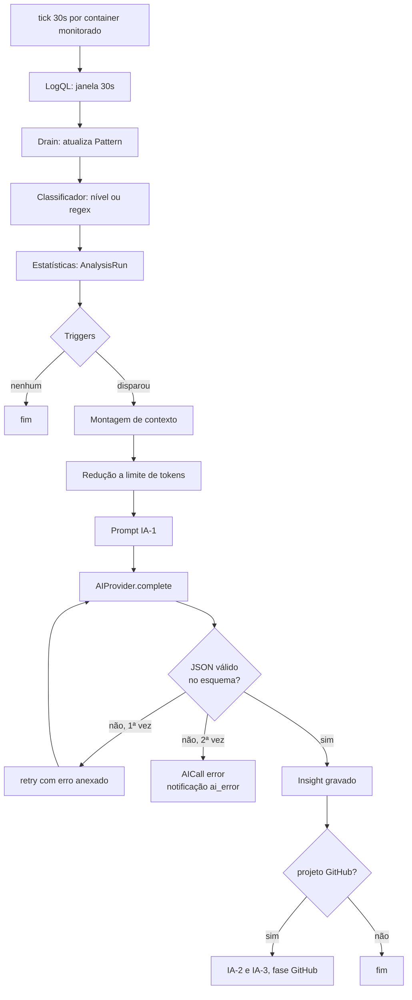

# Pipeline de Análise

**Status:** Aprovado por inteiro em 2026-11-24 · **Atualizado:** 2026-11-21

Do tick de 30 s ao insight gravado. Base: ADR 005, ADR 006, decisões de 2026-11-21 sobre contexto e esquema.

## 1. Visão geral



## 2. Montagem de contexto para o trigger de erro

Decidido em 2026-11-21. O contexto enviado à IA contém, nesta ordem de prioridade:

| # | Bloco | Conteúdo | Limite |
|---|---|---|---|
| 1 | Projeto | nome, host, imagem, tipo, compose project/service, variáveis seguras | sempre |
| 2 | Trigger | tipo, motivo, horário | sempre |
| 3 | Linhas de erro | todas as linhas classificadas como erro na janela, com timestamp e stream | até 100 linhas |
| 4 | Contexto anterior | até 50 linhas imediatamente antes da primeira linha de erro | 50 linhas |
| 5 | Eventos Docker | últimos 10 minutos: die, oom, restart, health, redeploy com imagens | até 20 eventos |
| 6 | Padrões | os 10 padrões mais frequentes do container, com contagem, e os padrões **novos** na janela | 10 + novos |
| 7 | Redeploy recente | se houve `redeploy` nas últimas 2 horas: imagem anterior, nova, horário | sempre que existir |
| 8 | Estado atual | `GET /containers/{id}/json`: estado, restarts, health | sempre |

Para trigger de **evento crítico**, o bloco 3 passa a ser "últimas 100 linhas antes do evento".
Para **anomalia**, o bloco 3 são amostras dos padrões que desviaram. Para **manual**, a janela é a
escolhida pelo usuário e o bloco 3 são todas as linhas de erro nela, com o mesmo limite.

## 3. Redução a limite de tokens

Orçamento de entrada por chamada: configurável, padrão 12 000 tokens. Se o contexto exceder, corta
nesta ordem até caber:

1. Contexto anterior, das linhas mais antigas para as mais novas.
2. Linhas de erro repetidas: colapsa linhas com o mesmo padrão em "linha X, repetida N vezes".
3. Padrões frequentes, mantendo só os novos.
4. Eventos, dos mais antigos para os mais novos.

Blocos 1, 2, 7 e 8 nunca são cortados. Se mesmo assim não caber, a chamada é feita com o que couber
e o insight recebe a marca `context_truncated = true`.

Linhas individuais com mais de 2 000 caracteres são truncadas no meio, preservando início e fim.

## 4. Chamada

Interface interna:

```python
class AIProvider(Protocol):
    async def complete(
        self,
        *,
        system: str,
        user: str,
        schema: dict,          # JSON Schema da resposta esperada
        max_output_tokens: int,
        purpose: Purpose,      # analyze | code_diagnosis | issue_text
    ) -> AIResult: ...         # text, input_tokens, output_tokens, cost_usd, cost_source, latency_ms, model
```

A implementação OpenRouter usa o formato de chat compatível com OpenAI, pede saída JSON quando o
modelo suportar e, quando não, instrui no prompt. O esquema vai no prompt em ambos os casos.

## 5. Validação e retry

Decidido em 2026-11-21: **esquema fechado, fora do esquema é retry.**

1. A resposta é parseada como JSON. Texto antes ou depois do JSON é descartado se houver exatamente
   um objeto JSON identificável.
2. O objeto é validado contra o JSON Schema do caso de uso. Campos extras são rejeitados.
3. Falhou: **um** retry, com o erro de validação anexado ao prompt e a resposta anterior citada.
4. Falhou de novo: `AICall.status = error`, notificação `ai_error` com o motivo, **nenhum insight criado**.
   Ambas as chamadas são contabilizadas.
5. Passou: `Insight` criado com `evidence` preenchido pelo backend, não pela IA. A IA referencia
   evidências por índice; o backend resolve para as linhas e eventos reais.

## 6. Esquema do Insight, IA-1

```json
{
  "type": "object",
  "additionalProperties": false,
  "required": ["severity", "title", "summary", "probable_cause", "suggested_action", "evidence_refs", "confidence"],
  "properties": {
    "severity": { "enum": ["critical", "high", "medium", "low", "info"] },
    "title": { "type": "string", "maxLength": 120 },
    "summary": { "type": "string", "maxLength": 1200 },
    "probable_cause": { "type": "string", "maxLength": 1200 },
    "suggested_action": { "type": "string", "maxLength": 800 },
    "evidence_refs": {
      "type": "array", "minItems": 1, "maxItems": 20,
      "items": { "type": "object", "additionalProperties": false,
        "required": ["kind", "index"],
        "properties": {
          "kind": { "enum": ["log_line", "docker_event", "pattern"] },
          "index": { "type": "integer", "minimum": 0 }
        } }
    },
    "confidence": { "type": "number", "minimum": 0, "maximum": 1 },
    "needs_code": { "type": "boolean" }
  }
}
```

`needs_code = true` em projeto GitHub aciona IA-2. Em projeto imagem, é ignorado.

## 7. Deduplicação de insights

**Não há deduplicação na v1.** Decisão de 2026-11-21. Enquanto um erro persistir, cada ciclo que o
encontrar gera um novo insight, mesmo que repetido. Deduplicação está no roadmap. O que limita o
custo na v1 é o ciclo em si: a IA só pode ser chamada uma vez por ciclo por container, e o ciclo só
recomeça 30 s depois que a chamada anterior termina. Ver seção 8.

## 8. Tempo do ciclo

Decisão de 2026-11-21: **os 30 segundos contam a partir do fim do ciclo anterior, incluindo a chamada
de IA**. O ciclo é sequencial por container:

```
analisa janela → (se trigger) chama IA e espera → grava insight → aguarda 30 s → recomeça
```

Consequências:

- A janela de cada ciclo vai do fim da janela anterior até agora. Não é fixa em 30 s. Se a IA levou
  20 s, a próxima janela terá cerca de 50 s. Nenhuma linha fica de fora.
- A IA nunca é chamada mais de uma vez a cada 30 s para o mesmo container, por construção.
- Containers são independentes: cada um tem seu próprio ciclo. Um container com IA lenta não atrasa os outros.
- Concorrência global de chamadas de IA limitada, padrão 3. Se o limite estiver cheio, o container
  espera sua vez dentro do próprio ciclo.
- `AnalysisRun.window_start` e `window_end` registram a janela real de cada ciclo.

O trigger **manual** roda fora desse ciclo, na hora, sobre a janela escolhida pelo usuário, respeitando
o limite de 1 por projeto por minuto e a concorrência global.

## 8.1 Implementado na 0.6.0

- Drain via `drain3`, um minerador por container em memória, reconstruído das amostras guardadas no
  reinício. O template de um cluster evolui; o texto final só é resolvido ao fim da janela. Quando
  evolui entre ciclos, nasce um `Pattern` novo. Limitação aceita; unificação fica no roadmap.
- Primeiro ciclo após a marcação limitado a 15 minutos de janela.
- Teto de 50 000 linhas por ciclo, com marca `truncated`.
- Anomalia exige 10 ciclos de base; critérios em `triggers.py`.
- Trigger manual limitado a 1 por minuto por projeto.
- **Um ciclo por container de cada vez.** Análise manual e ciclo automático compartilham uma trava
  por container. Sem ela processavam janelas sobrepostas e disputavam a criação dos mesmos padrões,
  estourando a unicidade `(container_id, template)`. Descoberto pelo CI na 0.8.0.
- A gravação de padrões usa upsert como rede de segurança: se duas transações criarem o mesmo
  template, as contagens somam em vez de falhar.
- Marcar um container dispara um ciclo imediato, antes da primeira pausa.

## 8.2 Implementado na 0.9.0

- O orçamento de tokens é estimado por caracteres divididos por quatro. Não é o tokenizador do
  modelo, mas erra para o lado seguro e não acrescenta dependência.
- A ordem de corte é a da seção 3: contexto anterior cai primeiro, depois linhas repetidas são
  colapsadas, depois padrões não novos, depois eventos antigos.
- Linhas acima de 2000 caracteres são truncadas no meio, preservando início e fim.
- As evidências são renumeradas de zero após cada corte, então os índices que a IA vê sempre existem.
- O validador confere os índices contra o contexto real: citar `log_line 9` quando só há três linhas
  é recusado com a faixa válida na mensagem, e isso vai no retry.
- Falha de rede ou recusa do provider **não** dispara o retry de esquema: só respostas malformadas.

## 9. Indicador de execução

A interface mostra um **executor**: lista do que está rodando agora, por projeto, com tipo de trigger,
fase (consultando, montando contexto, aguardando IA, gravando) e tempo decorrido. Serve para o usuário
saber que o pedido manual foi aceito e para enxergar a IA trabalhando nos ciclos automáticos. Alimentado
por WebSocket a partir do backend.
