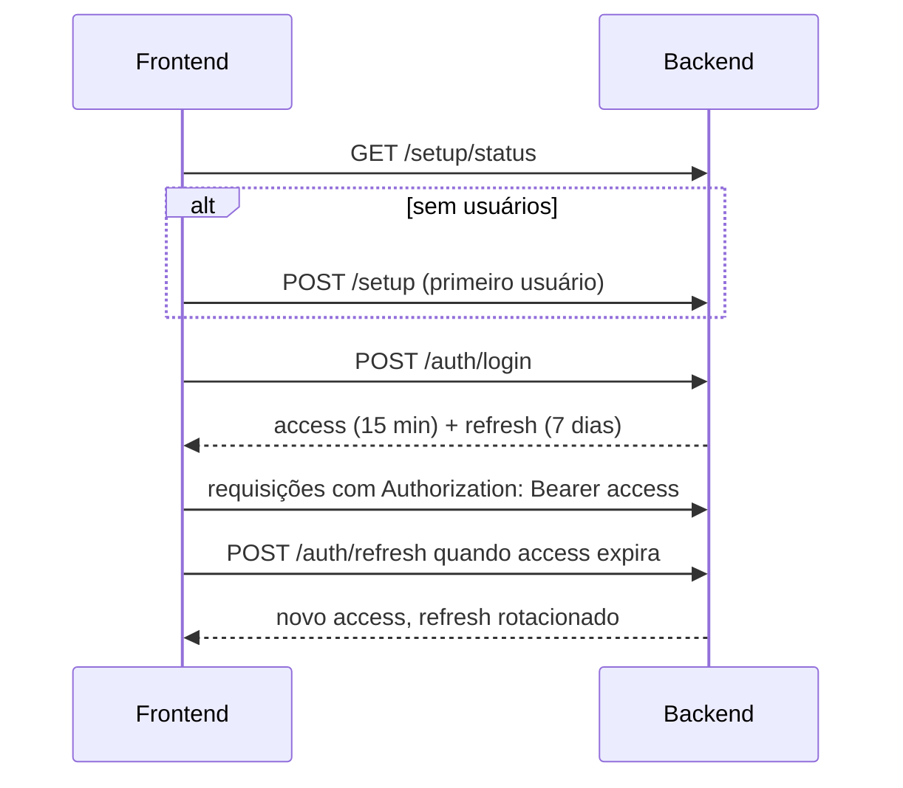

# Autenticação e Autorização

**Status:** Rascunho para revisão · **Atualizado:** 2026-11-21

Base: ADR 008.

## 1. Fluxo

## 2. Tokens

| Token | Duração | Onde fica no cliente | Conteúdo |
|---|---|---|---|
| access | 15 min | memória | `sub`, `exp`, `iat`, `jti` |
| refresh | 7 dias, rotacionado a cada uso | cookie `HttpOnly`, `Secure`, `SameSite=Strict` | `sub`, `exp`, `jti` |

- Assinatura HS256 com chave derivada de `LOGNIX_SECRET_KEY`.
- Refresh tokens têm `jti` gravado em tabela `RefreshToken`. Logout e rotação invalidam o anterior.
  Reuso de refresh já rotacionado invalida toda a família, sinal de roubo.
- WebSocket recebe o access token na abertura e é fechado quando ele expira; o cliente reconecta.

## 3. Senhas

- Hash com Argon2id, parâmetros padrão da biblioteca.
- Mínimo 10 caracteres. Sem outras regras de composição.
- Troca de senha exige a senha atual.
- Sem recuperação por e-mail na v1: outro usuário redefine pela tela de Usuários. Roadmap: e-mail.

## 4. Autorização

Nenhuma. Todo usuário autenticado acessa tudo. ADR 008. Preparação para RBAC:

- Toda rota declara uma dependência `require_user()`. Quando houver papéis, vira `require_role(...)`.
- Entidades com `created_by` e `seen_by` já registram autoria.

## 5. Proteções

- `/auth/login`: 10 tentativas por minuto por IP, depois `429`.
- Resposta de login não distingue usuário inexistente de senha errada.
- Primeiro usuário só pode ser criado via `/setup` com banco vazio; a rota passa a devolver `404` depois.
- Cabeçalhos de segurança no nginx: `X-Content-Type-Options`, `X-Frame-Options`, CSP restritiva.
