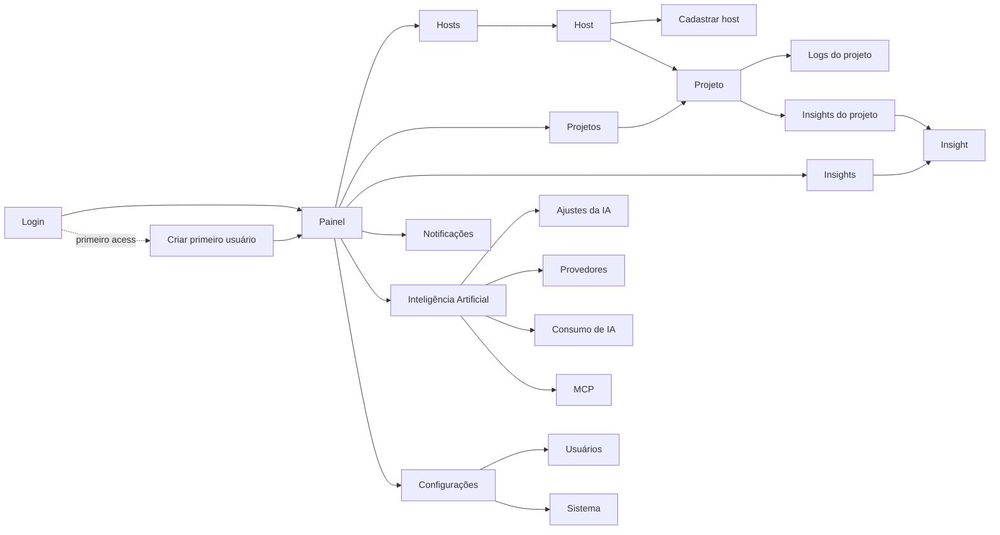

# Mapa de Telas

**Status:** Aprovado em 2026-11-21 · **Atualizado:** 2026-11-21

> **Nota de 2026-11-26.** A interface passou por dois redesenhos depois deste documento: a
> identidade própria (ADR 011) e a passagem de cartão para tabela nas telas de lista, mais o
> sidebar com grupos que abrem e a tela de entrada com cards. O que está descrito abaixo é a
> intenção de origem, que em boa parte sobreviveu; onde divergir, valem o
> [ADR 011](../02%20Arquitetura/ADR/ADR%20011%20Identidade%20Visual%20do%20Lognix.md) e o código.

Todas as telas da v1 e a navegação entre elas. Detalhes de cada uma em Telas Detalhadas.

## 1. Navegação

Barra lateral fixa com: Painel, Hosts, Projetos, Insights, Notificações e, na seção Ajustes, dois
grupos que abrem subitens — Inteligência Artificial e Configurações. Rodapé da barra: versão,
estado da IA, usuário logado.

**Mudou na 1.3.0:** a IA saiu de dentro de Configurações e virou grupo próprio, levando Provedores,
Consumo e MCP. Configurações ficou com o que é do próprio Lognix — quem entra e como ele está. O
motivo é peso: cinco subitens, quatro deles sobre IA, faziam de "Configurações" um balaio onde o
assunto principal do produto ficava escondido. Os caminhos antigos redirecionam.

## 2. Telas

| Tela | Rota | Propósito | Fase |
|---|---|---|---|
| **Login** | `/login` | usuário e senha, devolve JWT | 0.1.0 |
| **Criar primeiro usuário** | `/setup` | só aparece com banco sem usuários | 0.1.0 |
| **Painel** | `/` | tela inicial. Resumo de 24 h, hosts, notificações, projetos mais ativos, ocorrências recentes, executor. **Implementado na 0.8.0** | 0.8.0 |
| **Hosts** | `/hosts` | lista com estado da conexão, containers monitorados, último erro | 0.2.0 |
| **Cadastrar host** | `/hosts/new` | formulário, método de autenticação, validação em etapas com progresso visível, seleção inicial de containers | 0.2.0, seleção em 0.3.0 |
| **Host** | `/hosts/:id` | abas: Containers, Excluídos, Eventos, Config do Alloy, Conexão | 0.3.0, excluídos em 0.5.0 |
| **Projetos** | `/projects` | todos os containers monitorados, de todos os hosts, com estado e último insight | 0.3.0 |
| **Projeto** | `/projects/:id` | cabeçalho com host, imagem, estado, tipo; abas: Logs, Insights, Padrões, Eventos, Repositório | 0.4.0 |
| **Logs do projeto** | `/projects/:id/logs` | histórico via LogQL com filtro de texto, nível, stream e período; modo ao vivo com pausa; estado vazio pós-marcação explicado | 0.4.0 |
| **Insights** | `/insights` | todos os novos, filtro por host, projeto, severidade, trigger; visto individual; limpar todos; link para histórico | 0.8.0 |
| **Insight** | `/insights/:id` | título, severidade, confiança, resumo, causa, ação, evidências com link para as linhas no log, contexto enviado, custo da chamada, diagnóstico de código quando houver | 0.9.0 |
| **Histórico de insights** | `/insights/history` | vistos, mesmos filtros | 0.8.0 |
| **Ocorrências sem análise** | `/insights/unanalyzed` | triggers disparados sem IA | 0.6.0 |
| **Notificações** | `/notifications` | lista, visto, limpar todos, ações diretas: monitorar container novo, reconectar host, aceitar fingerprint | 0.5.0 |
| **Executor** | painel lateral, qualquer rota | análises em andamento | 0.6.0 |
| **Inteligência Artificial** | `/ai` | entrada em cards dos quatro subitens | 1.3.0 |
| **IA › Ajustes da IA** | `/ai/behavior` | interruptor geral, limites por chamada, aviso de dados sensíveis. Era `/settings/ai` | 0.8.0 |
| **IA › Provedores** | `/ai/providers` | cadeia de fallback, credenciais, modelos, verificação em etapas. Era `/settings/providers` | 1.0.0 |
| **IA › Consumo** | `/ai/usage` | chamadas, tokens, custo e confiabilidade por provedor. Era `/settings/usage` | 0.8.0 |
| **IA › MCP** | `/ai/mcp` | interruptor do servidor, chaves com escopo, catálogo de ferramentas, histórico de chamadas. Era `/settings/mcp` | 1.2.0 |
| **Configurações** | `/settings` | entrada em cards | 0.8.0 |
| **Configurações › Usuários** | `/settings/users` | cadastro e remoção de usuários | 0.1.0 |
| **Configurações › Sistema** | `/settings/system` | versão, retenção, estado dos loops, estado do Alloy e do Loki | 0.7.0 |
| **Minha conta** | `/conta` | troca da própria senha | 1.1.0 |
| **Configurações › GitHub** | `/settings/github` | App ID, chave, instalação | a seguir |

## 3. Estados que toda tela precisa tratar

- Carregando.
- Vazio, com explicação e ação: "nenhum host ainda, cadastre o primeiro".
- Erro de API, com retry.
- Sem IA configurada: telas de insight mostram aviso e link para configurar, não ficam em branco.
- Host desconectado: tudo que depende dele mostra o estado, com ação de reconectar.

## 4. Tempo real

| Tela | Canal |
|---|---|
| Logs ao vivo | WebSocket, tail do Loki via backend |
| Executor | WebSocket |
| Notificações e contador de insights na barra | WebSocket |
| Demais listas | TanStack Query com revalidação ao focar e a cada 30 s |
