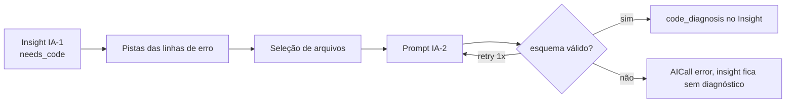

# Diagnóstico de Código

**Status:** Rascunho para revisão · **Atualizado:** 2026-11-21 · **Fase:** 1.4.0

Caso de uso IA-2. Combina insight, eventos e código para apontar o trecho.

## 1. Fluxo



Roda logo após IA-1, no mesmo ciclo, dentro do mesmo semáforo de IA. O ciclo espera.

## 2. Esquema `code_diagnosis`

```json
{
  "type": "object", "additionalProperties": false,
  "required": ["found", "confidence", "explanation"],
  "properties": {
    "found": { "type": "boolean" },
    "file": { "type": "string" },
    "start_line": { "type": "integer", "minimum": 1 },
    "end_line": { "type": "integer", "minimum": 1 },
    "explanation": { "type": "string", "maxLength": 1500 },
    "confidence": { "type": "number", "minimum": 0, "maximum": 1 },
    "alternative_locations": {
      "type": "array", "maxItems": 3,
      "items": { "type": "object", "additionalProperties": false,
        "required": ["file", "start_line", "end_line", "reason"],
        "properties": { "file": {"type":"string"}, "start_line": {"type":"integer"}, "end_line": {"type":"integer"}, "reason": {"type":"string","maxLength":300} } }
    },
    "missing_files": { "type": "array", "maxItems": 5, "items": { "type": "string" } }
  }
}
```

- `file` deve ser um dos arquivos enviados. Caso contrário, validação falha e vai para retry.
- O backend extrai o `snippet` real do arquivo com as linhas indicadas; a IA não copia código.
- `found = false` com `missing_files` dispara a rodada extra descrita em Leitura de Código seção 3.4.

## 3. Regras do prompt

- Só apontar código fornecido. Dizer quando a causa é externa: infraestrutura, dependência, dado.
- Distinguir "onde o erro é lançado" de "onde está o defeito". Preferir o defeito, citar ambos.
- Usar o redeploy, quando houver, como pista: "o que mudou entre as imagens" não está disponível na
  v1, mas a data do redeploy e o commit da nova imagem estão.

## 4. Na interface

Seção "Diagnóstico de código" no Insight: arquivo com link para o GitHub no ref exato, trecho com
números de linha e destaque, explicação, confiança, alternativas colapsadas. Quando o ref analisado
não é o commit da imagem rodando, aviso explícito.
