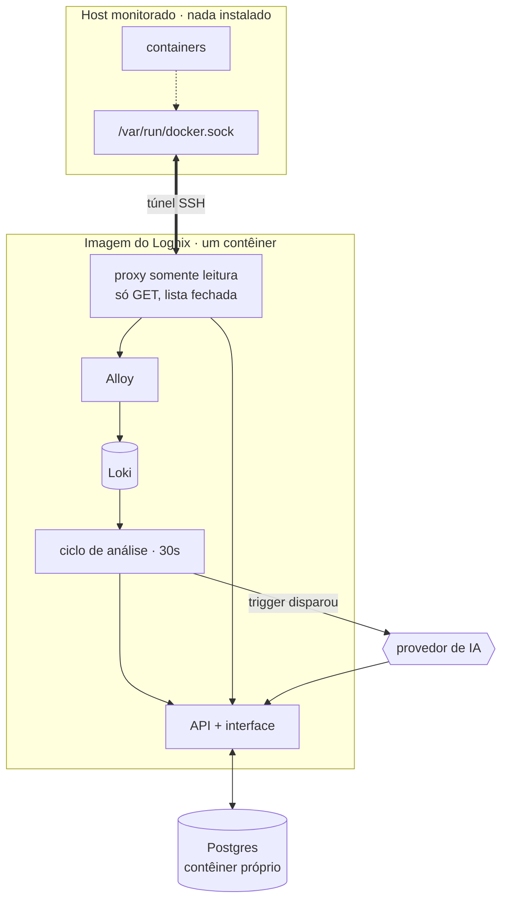

# Arquitetura

Visão de quem precisa entender o sistema por dentro sem ler o planejamento inteiro. O porquê de
cada decisão está nos [ADRs](https://github.com/juannobrega/lognix/blob/main/.documentation/Planning/02%20Arquitetura/ADR/README.md).

## O desenho em uma frase

O Lognix roda inteiro na sua máquina, alcança os hosts monitorados por SSH, lê os logs pela Docker
API sem instalar nada neles, guarda tudo no Loki, e analisa janelas de log em ciclos curtos.



## As peças

| Peça | O que faz | Onde |
|---|---|---|
| **API** | rotas, túneis, proxy, ciclos, IA — e serve o frontend construído | na imagem, `backend/lognix/` |
| **frontend** | a interface, servida pela própria API | na imagem, `/app/static` |
| **Alloy** | lê os logs dos containers e escreve no Loki | na imagem, config gerada pela API |
| **Loki** | as linhas de log, e só elas | na imagem, volume `loki-data` |
| **Postgres** | tudo que o Lognix produz: hosts, containers, padrões, ocorrências, insights, custos | contêiner próprio, volume `postgres-data` |

As quatro primeiras peças vivem **na mesma imagem**, porque a configuração das quatro é do Lognix
— a do Alloy é gerada pela API a cada mudança de monitoramento. O Postgres fica fora porque é um
banco: quem instala pode já ter um, ou querer gerenciado. Ver
[ADR 013](https://github.com/juannobrega/lognix/blob/main/.documentation/Planning/02%20Arquitetura/ADR/ADR%20013%20Distribui%C3%A7%C3%A3o%20como%20Imagem%20Docker.md).

Só a porta do Lognix é exposta. Loki e Alloy escutam apenas em `localhost`, dentro do contêiner.

## Como os logs chegam

1. O backend abre uma conexão SSH com o host e encaminha o socket do Docker para um arquivo local.
2. Entre esse arquivo e quem o consome existe um **proxy somente leitura**: ele deixa passar apenas
   `GET` numa lista fechada de caminhos. Nenhum comando de alteração chega ao host, e isso é
   verificado por teste automatizado no CI.
3. O Alloy enxerga aquele socket como se fosse um Docker local, descobre os containers marcados,
   lê seus logs e escreve no Loki com os labels do Lognix.
4. A configuração do Alloy é **gerada pelo backend**, um bloco por host, e recarregada sem reiniciar
   sempre que a seleção de containers muda. Cada versão fica guardada no banco.

O backend nunca lê linhas de log pela Docker API. Logs vêm sempre do Loki. A Docker API serve para
inventário, inspeção e eventos.

## O ciclo de análise

Cada container monitorado tem um laço próprio:

```
consulta a janela no Loki → agrupa em padrões (Drain) → classifica o nível de cada linha
   → grava o ciclo → avalia os triggers → se disparou e a IA está ativa, chama e espera
   → aguarda 30 s → recomeça
```

A janela vai do fim da janela anterior até agora, então nada se perde entre ciclos. Se o Loki
falhar, a janela **não avança**.

Quatro triggers: erro na janela, evento Docker crítico, anomalia estatística e análise manual.
Cada um que dispara vira uma **ocorrência**. Com a IA ativa, a ocorrência vira um **insight**.

Detalhe que importa para o desempenho: o trabalho do ciclo é CPU em Python puro. O laço cede o
event loop a cada 250 linhas e há um limite de ciclos simultâneos. Sem isso a interface trava
enquanto os ciclos rodam. Ver [ADR 010](https://github.com/juannobrega/lognix/blob/main/.documentation/Planning/02%20Arquitetura/ADR/ADR%20010%20Desempenho%20do%20Ciclo%20de%20An%C3%A1lise.md).

## A análise por IA

A IA nunca roda sozinha: só quando um trigger dispara. O backend monta o contexto, chama o
provedor e exige a resposta num esquema fechado.

```
trigger → monta contexto (linhas de erro, contexto anterior, eventos, padrões, redeploy, estado)
        → corta até caber no orçamento de tokens
        → cadeia de provedores, por prioridade:
            → chama o provedor pedindo JSON no esquema
            → valida; fora do esquema, um retry no mesmo provedor com o erro anexado
            → credencial, modelo, limite de uso ou indisponibilidade: desce para o próximo
        → grava insight + registro de custo, ou grava o erro e notifica uma vez
```

As evidências do insight são resolvidas pelo backend: a IA cita índices, o backend troca por linhas
e eventos reais. Isso impede que a IA invente uma evidência. Cada tentativa registra provedor, modelo,
tokens, custo, latência, a versão do prompt e se foi fallback.

São três tipos de provedor — OpenRouter, OpenAI e Amazon Bedrock —, cadastráveis em qualquer número e
ordenáveis pelo usuário. A ordem é a cadeia de fallback. Ver
[ADR 012](https://github.com/juannobrega/lognix/blob/main/.documentation/Planning/02%20Arquitetura/ADR/ADR%20012%20M%C3%BAltiplos%20Provedores%20de%20IA%20com%20Cadeia%20de%20Fallback.md).

## Onde mora o quê

| Dado | Onde | Retenção |
|---|---|---|
| Linhas de log | Loki | 15 dias, configurável |
| Eventos Docker e de host | Postgres | 15 dias |
| Ciclos de análise | Postgres | 7 dias |
| Padrões | Postgres | enquanto o container existir |
| Ocorrências, insights, chamadas de IA | Postgres | permanente |
| Credenciais SSH, credenciais dos provedores de IA | Postgres, criptografadas | permanente |

A chave de criptografia é derivada de `LOGNIX_SECRET_KEY`. Perdê-la torna as credenciais
irrecuperáveis.

## Processos em execução

Tudo num processo só, sem fila externa. Medido e documentado em
[ADR 009](https://github.com/juannobrega/lognix/blob/main/.documentation/Planning/02%20Arquitetura/ADR/ADR%20009%20Sem%20Redis%20na%20Primeira%20Fase.md).

| Laço | Um por | Cadência |
|---|---|---|
| ciclo de análise | container monitorado | 30 s após o fim do anterior |
| supervisor de túnel | host | verifica a cada 15 s |
| ouvinte de eventos | host | stream contínuo |
| reconciliação de inventário | host | 60 s, e por evento |
| tail de logs | projeto com espectador | enquanto alguém olha |

O estado de todos eles aparece em Configurações › Sistema.
