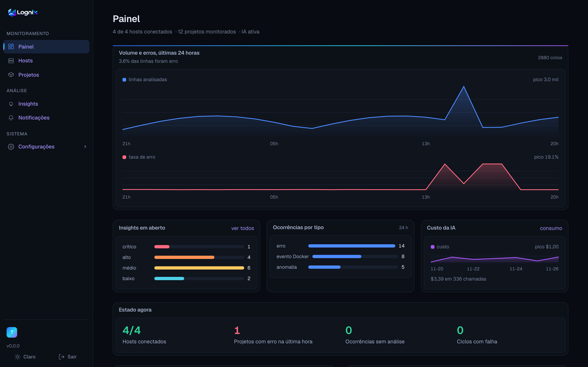

# Lognix

**Análise de logs de containers com IA, sem instalar nada nos seus servidores.**

O Lognix se conecta por SSH às suas máquinas, lê os logs dos containers pela Docker API, guarda
tudo no Loki e analisa janelas curtas em ciclo contínuo. Quando algo quebra, ele explica o que
aconteceu, cita as linhas que embasaram a conclusão e mostra quanto custou a análise.

```bash
curl -O https://raw.githubusercontent.com/juannobrega/lognix/main/docker-compose.yml
curl -O https://raw.githubusercontent.com/juannobrega/lognix/main/.env.example
cp .env.example .env            # gere LOGNIX_SECRET_KEY
docker compose up -d
```

Abra `http://localhost:8080` e crie o primeiro usuário. O guia de
[Instalação](Instalação.md) tem o resto.

{ loading=lazy }

/// caption
O painel, com dados de exemplo. A taxa de erro fica em gráfico próprio porque, somada ao volume,
a linha ficaria rente ao zero e esconderia exatamente o pico que alguém abre o painel para ver.
///

## Três decisões que definem o produto

!!! info "Nada é instalado no host monitorado"

    O Grafana Alloy roda ao lado do Lognix e enxerga o Docker remoto por um túnel SSH. A máquina
    monitorada não ganha agente, nem daemon, nem alteração de configuração. O único requisito é
    SSH com acesso ao socket do Docker.

!!! info "Somente leitura, garantido por código"

    Entre o túnel e quem consome existe um proxy que recusa qualquer requisição que não seja
    `GET` numa lista fechada de caminhos. Não é promessa: é teste automatizado no CI, e um
    contador de requisições bloqueadas visível na interface.

!!! info "A IA não escreve evidências"

    Ela cita índices do contexto, e o backend troca por linhas e eventos reais. Um índice
    inexistente é recusado na validação. Isso fecha a porta para o pior modo de falha de um
    produto assim, que seria citar um log inventado.

## Por onde começar

| Se você quer… | Vá para |
|---|---|
| rodar o Lognix | [Instalação](Instalação.md) |
| declarar a instalação num arquivo | [Configuração](Configuração.md) |
| usar no dia a dia | [Operação](Operação.md) |
| perguntar ao Claude sobre os seus logs | [Conectar uma IA](MCP.md) |
| saber o que mudou | [Mudanças](CHANGELOG.md) |

A referência da API é gerada pela própria instalação, em `/api/docs`.

## Privacidade

Trechos de log saem do seu ambiente **apenas** para o provedor de IA que você configurar, e isso
é avisado na própria tela. Se você criar uma chave [MCP](MCP.md), eles também saem para o cliente
de IA de quem tem a chave — por isso a chave tem escopo, prazo e registro de uso. Não há redação automática de dados sensíveis nesta versão. Variáveis de
ambiente nunca são enviadas por valor, só por nome.

Fora isso, nada sai: sem telemetria, sem verificação de atualização, sem chamadas a serviços do
autor. A IA é opcional, e o resto funciona com ela desligada. Detalhes em
[Operação](Operação.md#privacidade).

## Contribuir

O código, o guia de desenvolvimento e o registro das decisões de projeto estão no
[repositório](https://github.com/juannobrega/lognix). Vulnerabilidades, em privado:
[SECURITY.md](https://github.com/juannobrega/lognix/blob/main/SECURITY.md).
